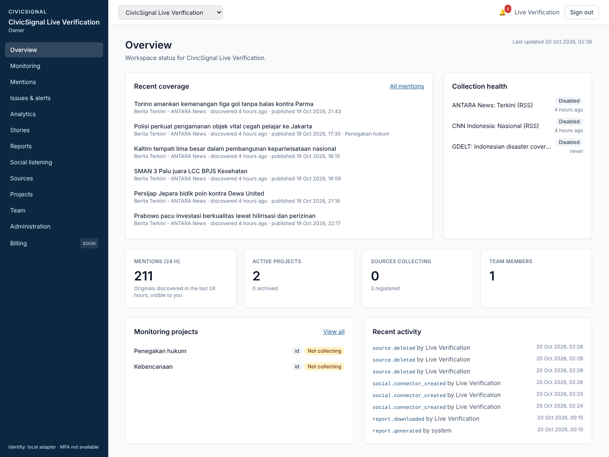

# CivicSignal Intelligence

Multi-tenant **media monitoring and public-issue intelligence** platform, built Indonesia-first. It collects news (and optionally
YouTube), detects issues and sentiment shifts, alerts the right people, and turns coverage into evidence-linked executive reports.



> **Ringkasan (Bahasa Indonesia)**
> - **Apa ini:** platform pemantauan media.
>   - Mengumpulkan berita dari feed RSS/Atom dan YouTube (opsional).
>   - Mengelompokkannya menjadi isu dan cerita.
>   - Menganalisis sentimen dan topik.
>   - Mengirim alert (email, webhook, WhatsApp).
>   - Membuat laporan PDF/CSV yang setiap klaimnya tertaut ke sumber.
>   - Banyak organisasi (tenant) dalam satu sistem, dengan data terisolasi.
> - **Status:** fitur inti sudah dibangun dan diuji otomatis (590 tes). **Belum production-ready**: belum ada server staging atau production, belum ada MFA, dan integrasi eksternal (AI, YouTube, email sungguhan) belum diverifikasi live. Detail di [status saat ini](#current-status).
> - **Coba di laptop:** instal Docker Desktop, lalu jalankan `bash scripts/local-up.sh` (Mac/Linux) dan buka http://localhost:3000. Panduan langkah demi langkah: [docs/LOCAL_SETUP.md](docs/LOCAL_SETUP.md). Kalau ingin sesi Claude Code di laptop yang mengerjakannya: [docs/LOCAL_SESSION_HANDOFF.md](docs/LOCAL_SESSION_HANDOFF.md).

---

## Contents
1. [What it does](#what-it-does)
2. [Current status](#current-status)
3. [Quick start (laptop, Docker)](#quick-start-laptop-docker)
4. [Architecture](#architecture)
5. [Repository layout](#repository-layout)
6. [Development without Docker](#development-without-docker)
7. [Testing and quality gates](#testing-and-quality-gates)
8. [Configuration](#configuration)
9. [External services and credentials](#external-services-and-credentials)
10. [Security and data governance](#security-and-data-governance)
11. [Deployment and operations](#deployment-and-operations)
12. [Documentation index](#documentation-index)

## What it does

| Area | Capabilities |
|---|---|
| **Organizations and users** | Self-registration, organizations (tenants), invitations, five roles (owner, admin, project manager, analyst, report viewer), sessions with idle timeout, password reset, audit log with a tamper-evident hash chain |
| **Projects and queries** | Projects with Boolean keyword queries, categories and monitored entities; project-level membership |
| **News ingestion** | RSS/Atom feeds and GDELT with an SSRF-safe fetcher, per-host politeness, conditional requests, canonical URLs, deduplication (hash, headline, similarity, within 36 h), and a per-source licence/authorization basis |
| **Social listening** | YouTube Data API connector (videos, comments) with provider-quota budgets, data-retention obligations and a derived-analysis rights gate |
| **AI analysis** | Sentiment, entities, topics and claims per article; story clustering; multi-article summaries. Every claim must be grounded in source text (numbers and quotes checked). Works with the Anthropic API or a rule-based **baseline** (default, no external calls, labelled in the UI). Token metering and per-tenant limits |
| **Issue detection and alerts** | Explainable rules (keyword, volume spike, negative shift, emerging topic, source concentration) with transparent severity points; an issue lifecycle; in-app, email, signed webhook and WhatsApp delivery; quiet hours, cooldowns and daily caps |
| **Analytics** | Coverage, sentiment, share of voice, sources, topics, entities and issues, in the organization's time zone |
| **Reports** | Five templates, an evidence workflow, PDF and CSV (formula-injection safe), schedules and email delivery |
| **Data governance** | Retention policies per data class, legal hold, four-eyes deletion requests, purge with evidence |
| **Commercial** | Versioned plans, subscriptions with a state machine, an idempotent usage ledger, quotas, contract and manual invoicing, a billing page, onboarding, and a platform console (tenants, plans, costs and margin, health, audit). **No live payment provider** |

More screens: [docs/screens/](docs/screens/) (analytics, issues, mentions, stories, reports, sources, social, billing, platform console, mobile).

## Current status

Evidence-based detail is in [docs/IMPLEMENTATION_STATUS.md](docs/IMPLEMENTATION_STATUS.md), the latest QA audit in
[docs/FULL_SYSTEM_QA_REPORT.md](docs/FULL_SYSTEM_QA_REPORT.md), and deployment readiness in
[docs/PILOT_DEPLOYMENT_AUDIT.md](docs/PILOT_DEPLOYMENT_AUDIT.md).

| | State |
|---|---|
| **Automated verification** | 34 API test suites / 590 tests and 20 web tests pass (unit, RLS, security, e2e, end-to-end lifecycle). Lint, typecheck, build, secret scan, licence check and `npm audit` (production) are clean. CI runs all of this plus a Trivy image scan and a full production-stack test |
| **Verified live** | RSS collection from public feeds (2026-10-19). Email only against a local SMTP server. Everything else, only in tests or the development container |
| **Not verified live** | Anthropic API, YouTube API, WhatsApp, a real SMTP relay, GDELT |
| **Environments** | **None deployed.** No staging or production exists. The deployment design, Compose stack, CI/CD and runbooks are ready (see [Deployment](#deployment-and-operations)) |
| **Readiness** | Ready for controlled internal testing and a staging deployment. **Not production-ready, and no certification** (ISO 27001, SOC 2, BSSN) is held or claimed |
| **Main blockers before a customer pilot** | Staging with real SMTP and backups. MFA through an external IdP. Fixes for the open P2 defects (QA report §11). Legal review of source licences and the AI provider's terms. A protected release branch (the remote has no `main`). The repository is currently public |

## Quick start (laptop, Docker)

**Requirements:** Docker Desktop (running, with at least 4 GB of memory), about 6 GB of free disk, internet access for the first build, and Chrome, Edge or Firefox.

```bash
git clone -b claude/youthful-darwin-rk5mhl https://github.com/njoups/pageroast.git
cd pageroast/civicsignal
bash scripts/local-up.sh                                          # macOS / Linux / WSL
# Windows PowerShell: powershell -ExecutionPolicy Bypass -File scripts\local-up.ps1
```

The script:
- creates `.env` with random local secrets (mode 0600, gitignored);
- picks free ports;
- builds and starts all services;
- waits for every health check, then prints the addresses.

| Address | What |
|---|---|
| http://localhost:3000 | The app: register, create an organization, then follow the in-app *Getting started* checklist |
| http://localhost:8025 | Mailpit: a local inbox that catches every email the app sends |

| Command | Effect |
|---|---|
| `docker compose stop` | Stop (data kept) |
| `bash scripts/local-up.sh --no-build` | Start again |
| `docker compose logs --tail 100 api worker web` | Logs |
| `docker compose run --rm migrate node apps/api/dist/database/promote-platform-admin-cli.js you@example.com` | Grant platform-admin rights (`/platform` console) |
| `docker compose down -v` | Delete everything, including data |

Guided walkthrough (Indonesian), including real news feeds to try: [docs/LOCAL_SETUP.md](docs/LOCAL_SETUP.md).

Verification of this setup:
- **Verified (2026-10-21) in the development container:** all services healthy, smoke test 18/18, password-reset email delivered to Mailpit.
- **Not yet confirmed** on a physical Windows or macOS laptop.

## Architecture

```
Browser ──> edge (Caddy) ──> web (Next.js 16, :3000) ──/api/v1/*──> api (NestJS 11, :4000) ──┐
                                                                                            ├── PostgreSQL 16 (RLS: one DB, isolated tenants)
                                   worker (same image as api: schedulers + BullMQ consumers) ┤
                                                                                            └── Redis 7 (queues, rate limits, heartbeats)
worker egress ──> RSS/Atom feeds, GDELT, YouTube API, Anthropic API, SMTP, webhook receivers
```

- **Tenant isolation:**
  - Every tenant table has `tenant_id` with **forced row-level security**.
  - The app connects as `civicsignal_app` (no BYPASSRLS, owns nothing) and sets the tenant per transaction (`withTenant`/`withSystem`).
  - Route guards check role permissions on top.
  - A cross-tenant test matrix runs in CI.
- **Same-origin web:** the browser talks only to the web origin. The web proxies `/api/v1/*` to the API, so cookies are first-party (`__Host-cs_session`). CSRF uses an origin check, and the CSP uses per-request nonces.
- **Worker:**
  - collection, analysis, clustering, alert evaluation, notifications, analytics aggregation, reports, retention, social lifecycle, and commercial ticks;
  - jobs are idempotent, retried with backoff and dead-lettered; deliveries are claimed atomically, so nothing is sent twice.
- **State:** PostgreSQL is the only system of record, and report files live in it with a TTL. Redis is transient.
- **Migrations:** plain SQL in `db/migrations`, forward-only, checksummed, locked in `db/migrations.lock`, and applied by a one-shot `migrate` job.

Details: [docs/ARCHITECTURE.md](docs/ARCHITECTURE.md).

## Repository layout
```
apps/api            NestJS API + worker (src/<module>: auth, organizations, projects, ingestion, social, analysis, alerts,
                    analytics, reports, governance, commercial, audit, health, database); tests in apps/api/test
apps/web            Next.js App Router UI (src/app: /o/[orgId]/..., /platform, auth pages; /healthz, /readyz)
db/migrations       SQL migrations 0001–0014 (+ db/migrations.lock)
infra/              compose.production.yml, Caddyfile(.production), env templates, monitoring (Prometheus rules)
scripts/            local-up.sh/.ps1 (laptop), smoke.mjs, stack-test.sh, check-migrations.mjs, backup.sh, restore.sh,
                    verify-restore.sh, scan-secrets.mjs, check-licenses.mjs, billing-test-event.mjs, load/ (load test)
docs/               design, operations, security, QA and runbooks (index below)
docker-compose.yml  local stack (laptop); production uses infra/compose.production.yml
```

## Development without Docker
Requires Node 22, PostgreSQL 16 and Redis 7.
```bash
npm ci
createdb civicsignal                                   # as an owner/superuser role
export MIGRATION_DATABASE_URL=postgres://<owner>:<pw>@localhost:5432/civicsignal
APP_DB_PASSWORD=<choose-one> npm run migrate           # schema, RLS, and LOGIN for civicsignal_app

# Terminal 1: API on :4000 (restricted, RLS-bound role)
cd apps/api && DATABASE_URL=postgres://civicsignal_app:<choose-one>@localhost:5432/civicsignal \
  MIGRATION_DATABASE_URL=$MIGRATION_DATABASE_URL REDIS_URL=redis://localhost:6379/0 npm run dev
# Terminal 2: worker (add SMTP_URL/EMAIL_FROM for email, ANTHROPIC_API_KEY for the AI model)
cd apps/api && DATABASE_URL=postgres://civicsignal_app:<choose-one>@localhost:5432/civicsignal REDIS_URL=redis://localhost:6379/0 npm run worker
# Terminal 3: web on :3000
cd apps/web && npm run dev
```
Platform admin: `MIGRATION_DATABASE_URL=... npx tsx apps/api/src/database/promote-platform-admin-cli.ts you@example.com`.

## Testing and quality gates
```bash
# Needs a Postgres role that can CREATE DATABASE and CREATE ROLE; the suite recreates civicsignal_test and flushes Redis db 15.
TEST_ADMIN_DATABASE_URL=postgres://postgres@localhost:5432/postgres TEST_REDIS_URL=redis://localhost:6379/15 npm test
npm run lint && npm run typecheck && npm run build
node scripts/scan-secrets.mjs --history      # secrets in tree and history (prints locations, never values)
node scripts/check-licenses.mjs              # production dependency licences
node scripts/check-migrations.mjs            # locked migrations unchanged; new ones expand/contract
npm run eval:ai -w apps/api                  # AI evaluation of the baseline (add -- --llm with a key)
API_IMAGE=... WEB_IMAGE=... bash scripts/stack-test.sh   # production Compose stack end to end (uses ports 80/443)
```

CI (`.github/workflows/civicsignal-ci.yml`):
1. secret and migration checks;
2. lint, typecheck, tests, build, audit, licences, restore drill;
3. image build with a Trivy scan;
4. production-stack test.

Deployment (`civicsignal-deploy.yml`) is manual and approval-gated.

## Configuration
- **Every setting is an environment variable**, validated at startup (`apps/api/src/config.ts`). Invalid or unsafe values stop the process with a message naming the variable; values are never logged.
- **Templates:**
  - `.env.example` (local);
  - `infra/env/staging.env.example`, `infra/env/production.env.example`, `infra/env/migrate.env.example`.
- **Environments:** `APP_ENV=local|staging|production`.
  - Staging and production require HTTPS origins, Redis, `TRUST_PROXY`, `CREDENTIALS_KEY`, `METRICS_TOKEN` and SMTP.
  - Staging only emails allow-listed recipients.
  - Production refuses every test-only switch.
- Full reference: [docs/DEPLOYMENT.md § Configuration](docs/DEPLOYMENT.md#configuration).

## External services and credentials

| Service | Needed for | Status |
|---|---|---|
| PostgreSQL 16, Redis 7 | Everything; queues | Required. Local only so far |
| SMTP relay | Alerts, reports, password reset | Local Mailpit / SMTP sink only. Required in staging and production |
| `CREDENTIALS_KEY` | Encrypting connector credentials and webhook secrets | Generated locally. Required in staging and production |
| `ANTHROPIC_API_KEY` | AI-model analysis | **Not configured**: the labelled baseline is used |
| YouTube Data API key | Social listening | **Not configured** (per connector); mock-tested only |
| WhatsApp Business Cloud API | Optional alert channel | **Not configured** |
| OIDC identity provider | MFA/SSO (blocking for production) | **Not implemented**: local passwords only |
| Payment provider | Self-service billing | **Not implemented**: contracts and manual invoices |
| Source licences | Every enabled source | Required: collection needs a recorded authorization basis |

## Security and data governance
- Controls and their verification state: [docs/SECURITY.md](docs/SECURITY.md).
- Data classes, AI data flow, retention, legal hold, deletion and social-platform obligations: [docs/DATA_GOVERNANCE.md](docs/DATA_GOVERNANCE.md).
- Never commit `.env` files or real credentials. CI's secret scan blocks them.

## Deployment and operations
| Topic | Document |
|---|---|
| Deployment audit and readiness | [PILOT_DEPLOYMENT_AUDIT.md](docs/PILOT_DEPLOYMENT_AUDIT.md) |
| Environments, staging procedure, production design, domain/TLS, secrets, release, migrations, rollback | [DEPLOYMENT.md](docs/DEPLOYMENT.md) |
| Backups, restore drill, RPO/RTO targets | [DISASTER_RECOVERY_RUNBOOK.md](docs/DISASTER_RECOVERY_RUNBOOK.md) |
| Incident response (11 scenarios) | [INCIDENT_RESPONSE_RUNBOOK.md](docs/INCIDENT_RESPONSE_RUNBOOK.md) |
| Day-to-day operations, queues, metrics | [RUNBOOK.md](docs/RUNBOOK.md) |
| First customer pilot | [PILOT_OPERATIONS_RUNBOOK.md](docs/PILOT_OPERATIONS_RUNBOOK.md) |
| Billing operations | [COMMERCIAL_OPERATIONS_RUNBOOK.md](docs/COMMERCIAL_OPERATIONS_RUNBOOK.md) |

## Documentation index
| Group | Documents |
|---|---|
| **Getting started** | [LOCAL_SETUP.md](docs/LOCAL_SETUP.md) (Indonesian) · [LOCAL_SESSION_HANDOFF.md](docs/LOCAL_SESSION_HANDOFF.md) |
| **Product** | [CONNECTORS.md](docs/CONNECTORS.md) · [SOCIAL_CONNECTORS.md](docs/SOCIAL_CONNECTORS.md) · [AI_PROVIDERS.md](docs/AI_PROVIDERS.md) · [AI_EVALUATION.md](docs/AI_EVALUATION.md) · [ALERT_RULES.md](docs/ALERT_RULES.md) · [NOTIFICATIONS.md](docs/NOTIFICATIONS.md) · [ANALYTICS_METHODOLOGY.md](docs/ANALYTICS_METHODOLOGY.md) · [REPORT_TEMPLATES.md](docs/REPORT_TEMPLATES.md) · [BILLING_AND_SUBSCRIPTIONS.md](docs/BILLING_AND_SUBSCRIPTIONS.md) · [USAGE_METERING.md](docs/USAGE_METERING.md) |
| **Engineering** | [ARCHITECTURE.md](docs/ARCHITECTURE.md) · [IMPLEMENTATION_STATUS.md](docs/IMPLEMENTATION_STATUS.md) · [IMPLEMENTATION_PLAN.md](docs/IMPLEMENTATION_PLAN.md) · [FULL_SYSTEM_QA_REPORT.md](docs/FULL_SYSTEM_QA_REPORT.md) · [LOAD_TESTING.md](docs/LOAD_TESTING.md) · [SUPPLY_CHAIN.md](docs/SUPPLY_CHAIN.md) |
| **Security and compliance** | [SECURITY.md](docs/SECURITY.md) · [DATA_GOVERNANCE.md](docs/DATA_GOVERNANCE.md) · [PRODUCTION_READINESS_ASSESSMENT.md](docs/PRODUCTION_READINESS_ASSESSMENT.md) · [COMMERCIALIZATION_AUDIT.md](docs/COMMERCIALIZATION_AUDIT.md) |
| **Operations** | See [Deployment and operations](#deployment-and-operations) |
